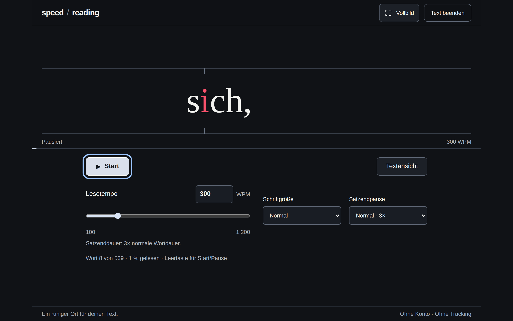

# Speed / Reading

Eine Speedreading-Web-App, die Texte Wort für Wort mit einem festen Ankerbuchstaben anzeigt (RSVP). Dunkle Fokusansicht für Desktop und Smartphone, ohne Konto, ohne Tracking und ohne Upload des Lesetextes.

**Live ausprobieren:** <https://evolving-thoughts.github.io/speed-reading/>



## Funktionen

- Text einfügen oder Beispieltext laden und mit 100 bis 1.200 Wörtern pro Minute lesen
- Fester roter Ankerbuchstabe pro Wort, lange Wörter werden automatisch verkleinert
- Einstellbare Pause am Satzende und vier Schriftgrößen
- Textansicht mit markierter Lesestelle und Wiedereinstieg an einem beliebigen Wort
- Tastaturbedienung (Leertaste, Pfeiltasten) und Vollbildmodus
- Lokal zusätzlich: Artikel per Link importieren, inklusive Bildern und Bildunterschriften
- Als Browser-Erweiterung: den Artikel oder markierten Text jeder Webseite direkt auf der Seite lesen, ohne Kopieren

Die öffentliche Version auf GitHub Pages ist rein statisch. Der Linkimport braucht den kleinen Node.js-Importdienst und ist deshalb nur bei lokaler Ausführung verfügbar.

## Browser-Erweiterung

Die Erweiterung (Chrome, Edge, Brave und andere Chromium-Browser) legt die Leseansicht über die aktuelle Seite. Sie erkennt den Artikel selbst, übernimmt dessen Bilder als Bildpausen und liest nur den markierten Text, wenn mindestens fünf Wörter markiert sind.

```sh
npm ci
npm run build:extension
```

Danach `chrome://extensions` öffnen, den Entwicklermodus einschalten und über „Entpackte Erweiterung laden“ den Ordner `dist-extension/` wählen. Gestartet wird über das Symbol in der Symbolleiste, mit `Alt+Umschalt+S` oder über das Kontextmenü „Mit Speed Reading lesen“. Ein zweiter Klick oder `Esc` schließt die Leseansicht; die Seite bleibt unverändert.

Die Erweiterung hat keinen dauerhaften Zugriff auf Webseiten (`activeTab`): Sie liest eine Seite erst, wenn du sie dort startest, und sendet nichts ins Netz. Tempo, Schriftgröße und Satzendpause merkt sie sich lokal im Browser. Details und Grenzen stehen in [docs/details.md](docs/details.md#browser-erweiterung).

## Tech-Stack

- React 19, TypeScript und Vite
- Node.js-Importdienst mit Mozilla Readability und jsdom (abgesicherter Abruf, signierte Bildlinks)
- Browser-Erweiterung (Manifest V3) mit derselben Leseansicht in einem Shadow DOM
- Vitest für Unit-Tests, Playwright für Browsertests auf Desktop- und Smartphone-Viewport
- GitHub Actions für Checks und das Deployment auf GitHub Pages

## Lokal starten

Voraussetzung: Node.js 24 (siehe `.nvmrc`) und npm.

```sh
npm ci
npm run dev
```

`npm run dev` startet die App und den Importdienst gemeinsam. Die App läuft unter <http://localhost:5173>.

Produktionsbuild lokal ansehen:

```sh
npm run build
npm run preview
```

## Tests

```sh
npm test               # Unit-Tests (Vitest)
npm run typecheck      # TypeScript
npm run format:check   # Prettier
npx playwright install chromium
npm run build:extension
npm run test:e2e       # Browsertests (Playwright), inklusive der gebauten Erweiterung
```

## Deployment

Jeder Push auf `main` baut die App mit `npm run build:pages` und veröffentlicht sie über GitHub Actions auf GitHub Pages. Dieser Build setzt den Pfad `/speed-reading/` und blendet den Linkimport aus (siehe `.env.pages`).

## Projektstruktur

- `src/state.ts`: Lesesitzung (reducer und abgeleitete Anzeigewerte)
- `src/screens/`: Eingabe-, Lese- und Textansicht
- `src/`: weitere Module für Leseschritte, Einstellungen, Zeitsteuerung und Linkimport
- `server/`: lokaler Importdienst für Artikel-Links
- `extension/`: Browser-Erweiterung (Texterkennung auf der Seite, Overlay, Manifest)
- `tests/`: Playwright-Browsertests
- `docs/details.md`: ausführliche Beschreibung von Bedienung, Importgrenzen und Datenschutz

## Lizenz

[MIT](LICENSE)
